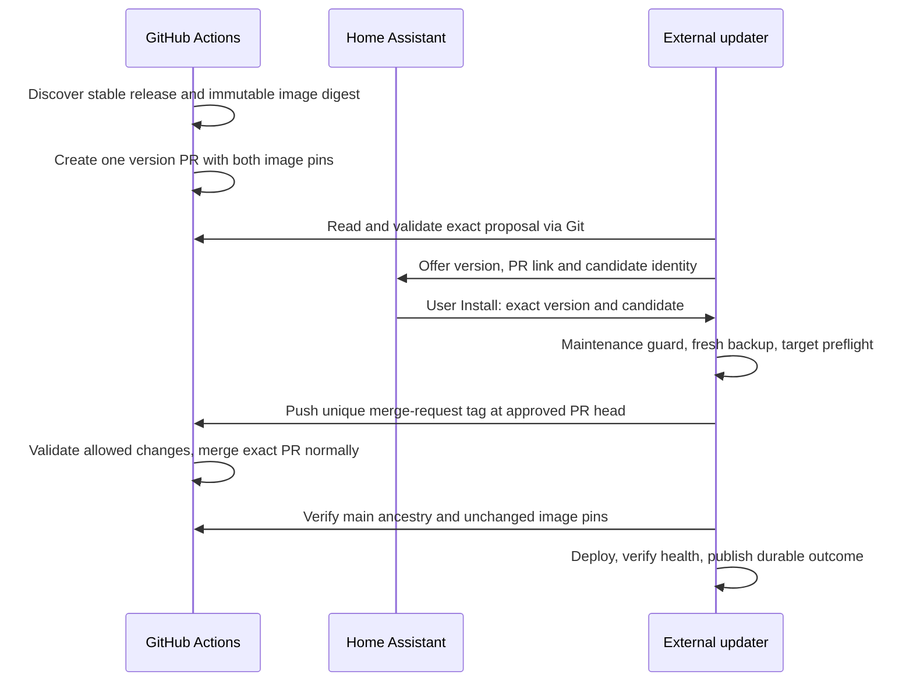

# Stable Core updates through a reviewed pull request

This optional mode adds a source proposal before the existing, explicit Core
approval. It does not change the default stable channel, enable unattended
installation, or downgrade an installed beta to an older stable release.

## Flow

The proposal changes only `helm/values-pajikos.yaml`,
`native_backup/cronjob.yaml` and `core_updates/candidate.json`. The manifest
contains public source metadata, not the private approval candidate or backup
receipt. Each version has one `ha-core-updates/VERSION` branch. A partially
created PR is completed on retry. A closed PR is not automatically reopened.

## Installation order

1. Import this release into the deployment repository. Copy
   `examples/workflows/core-update-proposals.yml` to its `.github/workflows/`.
   Keep `main` as the base branch. Configure the existing private automation
   runner labels or use the hosted runner fallback. Allow Actions to create PRs.
2. Run the workflow manually and verify its result. GitHub's built-in job token
   receives contents/PR write permission only in this job. The workflow needs no
   HA credential, Kubernetes access or additional personal token.
3. Set `proposal_workflow: true` in the external updater's private settings and
   reinstall its ConfigMap/deployment while idle. Recommended discovery interval:
   `check_interval_seconds: 900`; the proposal workflow runs hourly.
4. Install the `core_update_bridge` custom integration from the public HA
   configuration repository, using the existing private Bearer authorization.
   Set `native_update_entity: true` in the updater, then remove/rename only the
   retired MQTT registry entry before loading the native integration. Preserve
   `update.home_assistant_core` so notifications and maintenance guards retain
   their existing identity. Empty retained MQTT discovery retires the old entity;
   status topics remain available and never authorize installation.
5. Verify the native entity supports Install, specific version and release notes,
   the installed version is correct, and discovery alone has not run a backup,
   pushed a merge-request tag or changed the HA image.

The HA configuration repository is
[ha-homelab/home-assistant](https://github.com/ha-homelab/home-assistant).
Its `docs/core-native-updates.md` describes the bridge configuration and native
UI. The legacy approval endpoint and dashboard remain supported.

## Approval and failures

The native dialog sends its displayed version. The bridge compares its captured
candidate with freshly authenticated status before a single POST. The server
rejects stale, expired, already consumed or maintenance-blocked approvals. The
worker rechecks the exact proposal head before the backup and merge request.
A timeout is not automatically retried.

`ha-core-install/RANDOM` tags request source merges; they do not deploy anything.
The Actions job validates the same-repository PR, expected head, ancestry, file
allowlist and exact pin changes before using the ordinary GitHub merge API.
Branch protections remain effective. The worker must observe the approved head
in main, with both pins intact, before Helm. A premerged PR can still be installed
through explicit approval, including after automatic branch deletion.

If no proposal exists yet, check the scheduled workflow. If it cannot create a
PR, inspect Actions permissions. If merge confirmation times out, inspect the
workflow for the matching merge-request tag and the PR state. The updater records
ambiguous writes as recovery-required; never clear those flags just to retry.
Use the existing recovery/reoffer runbook after verifying actual cluster state.

Backup compatibility still requires reviewed source profiles. A new stable
release can be proposed but fail target preflight if its backup implementation
has changed. Review and release a compatible profile instead of bypassing that
check. Configuration-only backup remains an explicit site policy, independent
of proposal mode; the default sample still includes history.

## Verification scope

Tests cover proposal idempotency, partial creation, closed PRs, exact changes,
stale candidates, backup/preflight order, merge failure, and server-side
maintenance exclusion. They use synthetic repositories and never deploy Core.
The first real new version still needs the normal explicit Install and post-run
health checks. No simulated percentage is shown in the native UI.
