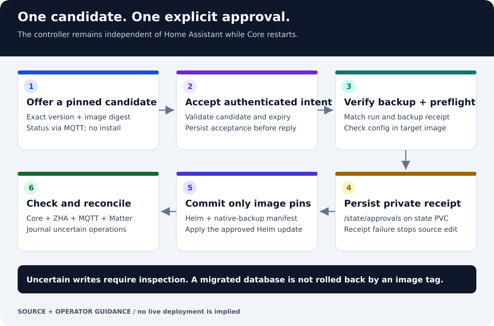
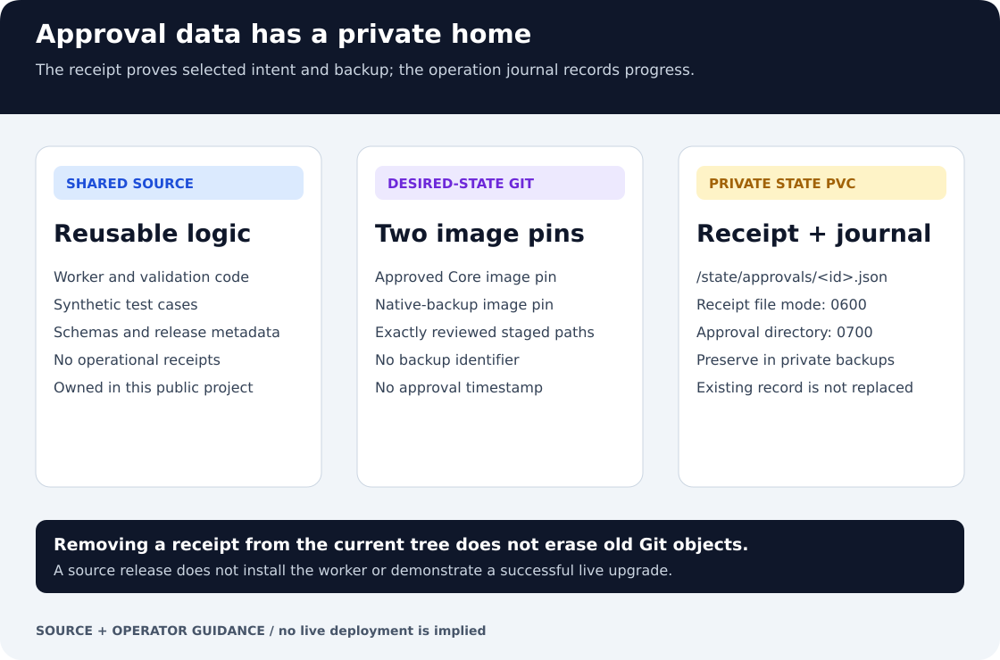

# Core updates: workflow and private evidence

The controller turns one authenticated approval into a guarded update attempt.
It runs independently of Home Assistant, so its durable operation state remains
available while Core restarts. Installing or releasing its source does not
approve an update.

## The update sequence

1. Discover a stable release and offer the exact version and image digest.
   MQTT reports status; it is not an install-command channel.
2. Authenticate approval, verify the candidate and persist acceptance before
   responding. A later release cannot silently replace the approved target.
3. Check maintenance readiness, run the required fresh backup and verify its
   matching receipt. Check a disposable configuration copy in the target image.
4. Before editing desired-state source, save the private approval receipt on the
   controller's state PVC. An unsafe directory or existing candidate receipt
   stops the operation rather than overwriting evidence.
5. Commit only the two approved image-pin files and perform the guarded Helm
   operation. Preserve journaled intent around operations with uncertain results.
6. Require the documented Core, ZHA, MQTT and Matter health checks before declaring
   success. Resolve interruptions using the durable state and matching backup.

See [maintenance](maintenance.md) for prerequisites and the complete operator
procedure, and [recovery](recovery.md) for restore boundaries.

## Where the data belongs

Reusable code, schemas and synthetic tests belong in this public repository.
The selected deployment repository receives the Helm and native-backup image
pins. Operational receipts belong under /state/approvals on the private state
PVC, with a 0700 directory and 0600 files. Preserve that state in private backups.

A receipt establishes the approved candidate and selected backup, not the result
of deployment. Consult the operation journal for progress or ambiguous writes.
Deleting an old receipt from current source does not erase historical Git objects.

## Result and regression evidence

The change in [PR #8](https://github.com/ha-homelab/k3s-self-healing/pull/8) moved
approval receipts out of Git while retaining the guarded update lifecycle.
The worker tests exercise real temporary Git repositories to inspect exactly
which paths are staged, as well as private-receipt refusal and failure cases.

Run these source checks in the documented validation environment:

~~~sh
python tools/validate.py
python -m unittest discover -s tests -p 'test_core_update_worker.py' -v
~~~

The first command also checks the explicit publication inventory and imported
HA source integrity. The tests use fixtures, not the running cluster. Broader
source and HA runtime suites remain part of release qualification; consult
[release packaging](release-packaging.md). None of these checks demonstrates a
live upgrade, backup restoration or device reconnection.

## Ownership and packaging

The controller, backup and restore implementation are maintained here.
Selected HA packages and tests are imported from their pinned upstream source;
edit those at their owner and refresh the lock through the documented
[ownership process](publication.md#shared-source-ownership).

The two SVG diagrams and this guide are included in publication.json so they
travel with the deterministic source archive. They are text-only assets with
no remote fonts, scripts, operational addresses or embedded private receipts.

## Troubleshooting and recovery boundaries

- **Managed source drift:** make the implementation change at its canonical
  owner; do not edit generated copies or bless drift by changing a hash alone.
- **Receipt cannot be written safely:** inspect state-volume ownership,
  permissions and the prior record. Do not clear evidence to force a retry.
- **Interrupted commit, push or Helm operation:** inspect the journal and actual
  state. Replaying an uncertain operation is not a safe default.
- **Backup or preflight fails:** address that failure before a separately
  authorized retry; receipt checks must remain mandatory.
- **Core may have migrated its database:** use the verified recovery procedure.
  Selecting an older image is not a general database rollback.
- **Old receipt is still visible in history:** preserve necessary evidence in
  protected storage, then handle historical copies separately from this source
  fix. This guide does not claim that any repository history was sanitized.
